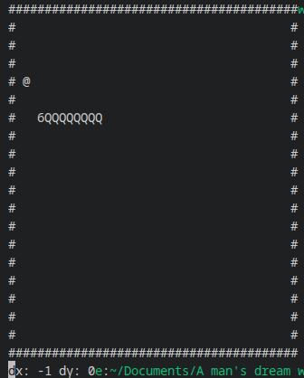

A Snake game developed in C++ as a practical exercise in learning and applying C++ concepts.

## Gameplay

## Concepts explored

- STL containers (`std::vector`, `std::pair`)
- References and memory management fundamentals
- Random number generation
- Terminal input handling using POSIX `termios`
- Game loops and coordinate-based movement
- Collision detection
- Time-based events using `std::chrono`